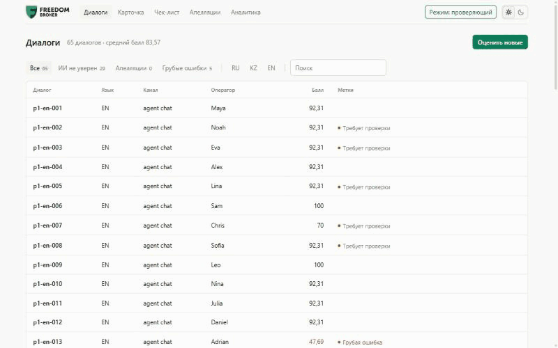

# CQA Judge — Conversation Quality Analytics

Prototype for the Freedom Broker hackathon: scoring an operator's work against a configurable checklist (RU / KZ / EN, chats and calls),
with explanations that link to the exact message and to the moment in the recording, appeals with review, operator feedback and analytics.
The interface is in Russian; Russian labels are shown in quotes with their English meaning.



*A real run of the interface in demo mode: open a conversation, jump from "Требуют проверки" (Needs review) to the evidence, dispute a score, and see the outcome and the new total in one line.*

## Run with Docker

```bash
cp .env.example .env   # fill in the keys and DATASET_API_URL
docker compose up -d --build
```

Open http://localhost:8000. The SQLite database lives in the `cqa-data` volume and survives restarts; keys are read from `.env`
at startup and are not baked into the image. Stop with `docker compose down` (data is kept), wipe the data with
`docker compose down -v`.

## Run without Docker

Requires Python 3.10+.

```bash
cd backend
pip install -r requirements.txt
cp ../.env.example ../.env   # fill in the keys and DATASET_API_URL
python -m uvicorn app.main:app --port 8000
```

Open http://localhost:8000: the backend serves the interface from `web/` itself.

1. "Диалоги" (Conversations) → "Оценить новые" (Evaluate new) → `group_id` (for example `DEV`) → the set is loaded from the organizers' API and evaluated.
2. Conversation view: score, gross errors, operator feedback, and for every criterion the answer, points, explanation,
   links to messages and the opinions of Gemini and Jev. For calls there is a player, and clicking a message seeks the recording.
3. "Оспорить" (Dispute) → an appeal. The "Проверяющий" (Reviewer) switch or the "Апелляции" (Appeals) screen → a decision (you can ask the AI
   to re-check) → the total is recalculated and the original score is kept.
4. "Чек-лист" (Checklist) → change or replace a criterion → "Сохранить и применить" (Save and apply) to the set. A new version is saved.
5. "Аналитика" (Analytics) → average scores by language, channel, operator and criterion, model agreement, cost.

Swagger: http://localhost:8000/docs · API description: [API.md](API.md) · Demo without a backend: http://localhost:8000/?demo=1

## How the evaluation works

```
conversation ─┬─► Gemini  (facts about the conversation, an answer per criterion, explanation, evidence messages, feedback)
              └─► Jev     (an independent answer per criterion + a calibrated probability)
                       │
                       ▼  merge per criterion
   agree ─► Gemini's answer          adjacent scale steps ─► Gemini's answer
   disagree, Jev confident (≥0.8)    ─► Gemini re-checks the criterion, flagged "disputed"
   disagree, Jev not confident       ─► Gemini's answer, flagged "needs review"
                       │
                       ▼  code (not a model)
   quote check against the transcript → N/A rules → points by weight → N/A redistribution → total (2 decimals) → gross errors
```

- Prompts and response schemas are generated from the checklist config: a new or replaced criterion works without code changes.
- Every evaluation really calls the models (no cache by `conversation_id`) and stores a snapshot of the checklist it was made with.
- Jev is optional: without a key, or on error, the evaluation runs on Gemini only.

## Tests

```bash
cd backend
python -m pytest -q
```

25 offline tests (no network or keys, the models are replaced with stubs): scoring and N/A, merging Gemini and Jev answers
(agreement, re-check, the "needs review" flag, Jev failure), validation of message links, the full path through the API
(upload → evaluation → appeal → decision → recalculation → statistics), criterion replacement and checklist validation.

### Run on a random sample (real models)

```bash
cd backend
python scripts/eval_sample.py --n 12 --runs 2            # random sample, stratified by language and channel
python scripts/eval_sample.py --n 12 --runs 2 --seed 7   # reproducible sample
```

The report is saved to `backend/reports/`. DEV has no ground truth, so the report shows correctness (valid answers,
real message links), consistency with the N/A rules, stability (the same conversation twice) and model agreement.
To measure accuracy, label the sample by hand:

```bash
python scripts/eval_sample.py --make-gold-template eval/gold.json --n 15   # template with empty answers
python scripts/eval_sample.py --gold eval/gold.json                         # per-criterion accuracy and total MAE
```

## Configuration (`.env`)

| Variable | Purpose |
|---|---|
| `GOOGLE_API_KEY`, `GEMINI_MODEL` | Gemini (default `gemini-3.8-flash`) |
| `TYPESAFE_API_KEY`, `JEV_MODEL`, `JEV_ENABLED` | Jev by TypeSafe AI (`jev-latest`) |
| `JEV_ADJUDICATE_THRESHOLD` | Jev probability above which a disagreement is sent for a re-check (0.8) |
| `DATASET_API_URL` | the organizers' GET link **without** `group_id` (it contains a signature, do not commit it) |
| `GEMINI_PRICE_IN_PER_M`, `GEMINI_PRICE_OUT_PER_M` | price per 1M tokens for cost estimates; check against Google's price list |
| `MAX_CONCURRENCY` | parallel evaluations in a batch (4) |
| `DATABASE_URL` | defaults to SQLite `backend/cqa.db` |

## Cost of one evaluation

One Gemini call (~3–4k input tokens, ~1.5k output plus reasoning), another one if the models disagree;
plus a Jev call (~6k input tokens, $0.042 / 1M). On the DEV set the average is about $0.01 per conversation (at the prices in `.env`).
The actual cost of each evaluation is shown in the conversation view and on the "Аналитика" (Analytics) screen.

## Structure

| Path | What it is |
|---|---|
| `backend/app/checklist.py` | checklist schema + the starter checklist from the PDF |
| `backend/app/scoring.py` | deterministic scoring (tests: `cd backend && python -m pytest -q`) |
| `backend/app/prompts.py` | prompts and JSON schemas, generated from the checklist |
| `backend/app/llm/` | Gemini and Jev clients |
| `backend/app/pipeline.py` | evaluation: Gemini ∥ Jev → merge → quote check → points |
| `backend/app/routers/` | API: conversations, checklists, evaluations, appeals, stats |
| `backend/tests/` | offline tests (`python -m pytest -q`) |
| `backend/scripts/eval_sample.py` | random-sample run with a report |
| `Dockerfile`, `docker-compose.yml` | image and one-command startup |
| `web/` | interface in plain HTML, CSS and JavaScript, no build step; `web/js/backend.js` talks to the API |
| `web/dist/cqa-webresource.html` | the whole interface in one file for Dynamics 365 (`python web/build.py`) |

Interface parameters (`?api=`, `?embed=1`, `?theme=`, `?demo=1`) and Dynamics 365: [web/README.md](web/README.md).
